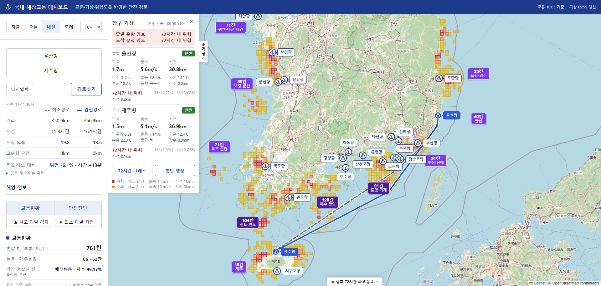
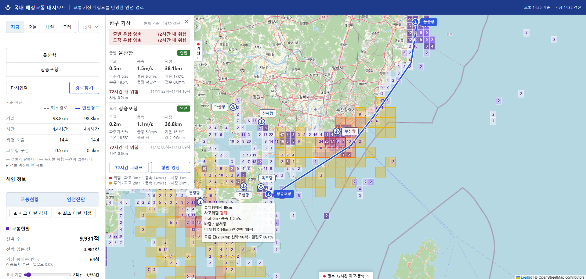

# 해상교통 안전경로 예측 시스템

> 출발·도착 항구를 고르면 거리만 보는 **최소경로**와 교통·사고위험·날씨를 반영한 **안전경로**를 지도에 함께 보여주는 출항 전 항해 계획 도구


## 개요

| 구분 | 내용 |
| --- | --- |
| 팀 | Hello_World (4인) |
| 기간 | 2026.10.17 ~ 11.12 (약 4주) |
| 내 역할 | 팀장 · 서버와 지도 뼈대 · 항구 선택·자동완성 · 팀 코드 통합 · 항만 CCTV 연동 · 머신러닝 검증 |
| 작업일지 | [Notion 작업일지](https://app.notion.com/p/4055abab4a9a817c8159d70b01a899b7) |

바다는 파고·풍속·교통량이 시시각각 바뀌어서 짧은 길과 안전한 길이 같지 않습니다. 실시간 내비게이션이 아니라, 예보(오늘~모레)를 보고 출항 전에 계획을 세우는 도구입니다.

## 화면





## 주요 기능

- **경로 탐색**: 최소경로(점선)와 안전경로(실선)를 그리고 거리·시간·위험 노출을 비교
- **출항 시각별 경로**: 시각을 바꾸면 그 시각의 예보로 안전경로를 다시 계산
- **교통·안전진단**: 실시간 선박 밀집도, 사고위험 예보 등급, 사고 다발 격자와 좌초 지점
- **항구 기상 패널**: 72시간 파고·풍속 그래프, 위험선 표시
- **항만 영상(CCTV)** 11곳, **무역항 31곳** 선택·자동완성

## 구조

```
MTIS · Open-Meteo (주기 수집)
   ↓
바다 격자 500m (Python · numpy)
   ↓
위험도 조립 (교통 · 사고위험 예보 · 날씨, Java)
   ↓
A* 두 번 실행 → 최소경로 + 안전경로
   ↓
Spring Boot · MyBatis · MariaDB · Thymeleaf · Leaflet
```

비용은 `거리 × (1 + α × 위험)`이고, 위험 가중치는 **교통 0.5 · 사고예보 0.3 · 날씨 0.2**입니다. 비중을 11가지로 바꿔 가며 MTIS가 지정한 사고다발 26칸이 앞에 오는지로 채점해 정했습니다(교통만 64.9%, 임의 비중 79.8%, 최종 85.6%).

## 결과

| 항목 | 결과 |
| --- | --- |
| 안전경로의 평균 위험점수 | 최소경로 대비 −22.6% |
| 경로를 못 찾은 구간 | 없음 |
| 경로의 육지 통과 비율 (110m 해안선 기준) | 0.136% |

## 문제 해결

**1. 경로가 육지와 섬을 지나가던 문제**
- 격자를 2.5km로 만들었더니 섬이 촘촘한 곳에서 좁은 수로가 바다로 처리돼, 110m 해안선으로 재측정하면 경로의 3~16%가 육지 위였습니다.
- 500m 격자에 바다 비율 80% 이상인 칸만 통과시켜 0.136%로 낮췄습니다. 내가 만든 격자로 검증하면 항상 통과하므로, 더 정밀한 해안선으로 따로 검증했습니다.

**2. 날씨로 사고를 구분할 수 있는가** ([일지](https://app.notion.com/p/40d5abab4a9a813f80e7d07bceee3f84))
- 사고 1건마다 같은 장소·달·요일의 평소 날을 붙이는 설계로 로지스틱 회귀를 검증했지만 AUC 0.549로 동전 던지기 수준이었습니다. 정확도 77.3%는 전부 "무사고"로 찍어도 나오는 값이라 AUC로 판단했습니다.
- 날씨를 사고 예측 변수가 아니라 운항 한계 판정(파고 4m · 풍속 20m/s)으로 바꾸고, 날씨가 이미 반영된 MTIS 사고위험 예보와 실시간 교통을 가져왔습니다.

**3. 영상 주소가 Git 이력에 남은 문제** ([일지](https://app.notion.com/p/40d5abab4a9a81ca96b2e2268487ed4c))
- 항만 영상 주소는 GitHub 등에 노출하면 안 되는 조건이라, 코드뿐 아니라 과거 커밋 이력에서도 지워야 했습니다.
- 영상 주소와 DB 정보를 `.env`로 분리하고 이력을 정리한 새 저장소로 옮긴 뒤, 새로 받아 주소·비밀번호가 0번 나오는지 검사했습니다.

## 한계와 개선 방향

- 사고다발 26칸은 가중치 채점용, 좌초 87곳은 표시용이라 경로에 직접 반영하지 못했습니다. 사고위험 예보를 통해 간접적으로만 반영됩니다.
- 암초는 좌초 지점만 모았고, 수심은 2차원 격자라 반영하지 못했습니다.
- 육지 통과가 0%는 아니어서 실제 항해에 쓸 수 있는 수준은 아닙니다.

## 실행 방법

1. MariaDB에 `sql/ports.sql`을 실행합니다.
2. 프로젝트 루트에 `.env`를 만들고 `MTIS_KEY`, `CCTV_BASE`, `DB_HOST`, `DB_PASSWORD`를 입력합니다. (저장소에는 포함되어 있지 않습니다.)
3. 서버를 실행한 뒤 브라우저에서 출발·도착 항구를 선택합니다. `.env`를 고친 뒤에는 서버를 다시 시작합니다.

> 항만 영상 주소와 API 키는 이용 조건에 따라 저장소에 포함하지 않았습니다.

## 배운 점

1. **받은 자료를 그대로 믿지 않기** — 항구 좌표 일부가 5km 넘게 틀려 있었습니다.
2. **높은 점수가 잘한 게 아니다** — 정확도 77.3%는 전부 무사고로 찍어도 나오는 점수였습니다.
3. **내 기준으로 내가 검증하면 항상 통과한다** — 다른 기준(110m 해안선)으로 다시 재야 문제가 보였습니다.

## 프로젝트 시리즈

1차 냉·난방 AS기사 스케줄 관리 · 2차 전력사용량 예측 대시보드 · 3차 해상교통 안전경로 예측 시스템 (이 저장소)
